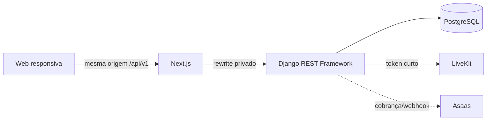

# Arquitetura do LingoQuest

## Decisão central

O produto começa como monólito modular: Django/DRF concentra domínio, autorização, transações e
integrações; Next.js entrega a experiência web; PostgreSQL é a fonte de verdade. LiveKit e Asaas
serão adaptadores opcionais e não poderão impedir o núcleo acadêmico de funcionar.

## Limites de domínio

| Módulo | Responsabilidade | Não deve conhecer |
|---|---|---|
| `accounts` | identidade, papéis, convite e perfis | regras de XP ou pagamento |
| `learning` | currículo, publicação, tentativas e progresso | SDK de vídeo |
| `gamification` | ledger de XP e conquistas | preço de plano |
| `notebook` | notas privadas do aluno | observação do professor |
| `classroom` | turmas, agenda, participantes e presença | dados de cartão |
| `assignments` | tarefa, destinatário, entrega e correção | cobrança |
| `billing` | plano, assinatura, fatura e eventos | gabarito de lição |
| `audit` | eventos críticos append-only | segredos ou payloads sensíveis |
| `integrations` | tradução para LiveKit/Asaas | decisão de autorização |

Cada endpoint restringe o universo em `get_queryset()` antes de serialização e aplica regra de
objeto no backend. Serviços de domínio encapsulam apenas operações transacionais relevantes; não
se cria uma camada genérica de “service” sem regra de negócio.

## Fluxos críticos

### Conclusão de missão

1. validar matrícula, publicação e dono da tentativa;
2. bloquear/finalizar a tentativa em transação;
3. calcular resultado somente no servidor;
4. atualizar progresso monotônico;
5. emitir `XPEvent` com unicidade por origem;
6. desbloquear conquistas idempotentemente;
7. devolver o estado consolidado também em requisição repetida.

### Aula ao vivo

1. agenda e autorização existem no banco independentemente do provedor;
2. `join` valida usuário, participante, estado e janela de horário;
3. o adaptador emite link externo validado ou token LiveKit curto e restrito à sala;
4. credenciais nunca chegam ao bundle ou ao banco em texto;
5. modo sem LiveKit continua funcional e honesto.

### Pagamento

1. fatura interna nasce antes ou junto da requisição ao provedor com referência única;
2. timeout exige reconciliação antes de nova criação;
3. webhook autenticado é persistido por `provider + event_id`;
4. processamento idempotente confere cobrança, valor e estado;
5. divergência vira conciliação/auditoria, nunca edição silenciosa.

## Escala planejada

- **Agora:** um banco, um backend, um frontend e um professor; tarefas síncronas curtas.
- **Primeiro gargalo:** consultas/índices, cache HTTP, pool de conexões e tarefas agendadas.
- **Depois:** workers e Redis apenas para e-mails, webhooks ou tarefas que comprovadamente exigirem.
- **Múltiplas instâncias:** backend stateless; sessão em banco/cache compartilhado; mídia fora do disco.
- **Multi-tenancy:** somente após modelo econômico B2B; introduzir `Organization` e isolamento em uma
  decisão arquitetural própria, com migração e testes de vazamento.

Microserviços não resolvem nenhum risco atual e aumentariam deploy, observabilidade, consistência e
custo. A modularidade de código preserva uma extração futura se volume ou equipes justificarem.

## Ambientes e deploy

O Railway deve ter um projeto por produto, ambientes separados (`staging` e `production`) e três
serviços: frontend, backend e PostgreSQL. O monorepo usa diretórios raiz `/frontend` e `/backend`;
cada serviço possui `railway.toml`. Nenhum recurso foi criado na Fase 0.

Em produção, o domínio público deve encaminhar `/api/*`, `/health/` e o webhook ao backend,
preservando uma única origem para sessão e CSRF. O endpoint administrativo deve ser restrito. As
orientações seguem a documentação oficial de
[monorepos do Railway](https://docs.railway.com/deployments/monorepo).

## Regras de evolução

- mudança de domínio, autorização ou infraestrutura exige ADR em `docs/adr/`;
- migrations são revisadas e aplicadas antes de tráfego depender delas;
- toda tabela histórica usa arquivamento/proteção em vez de exclusão casual;
- todo fluxo crítico tem teste positivo, negativo, IDOR e repetição/concorrência;
- nenhum provedor é “validado” apenas com mock;
- logs contêm `request_id`, estado e código técnico, nunca token, senha ou conteúdo privado.

