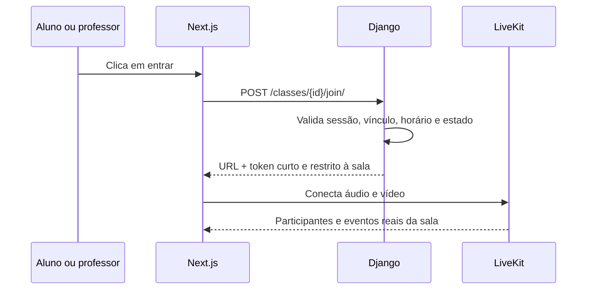

# Plano de evolução e implantação do LingoQuest

## Objetivo

Evoluir o LingoQuest de uma demonstração de aprendizado A1 para uma escola digital operável, na
qual o aluno estuda durante a semana e encontra um professor que já conhece suas dificuldades. O
produto deve gerar evidência de aprendizagem, reduzir o trabalho operacional do professor e manter
uma experiência adulta, simples e acolhedora.

O ciclo principal do produto é:

```text
diagnóstico → missão curta → erro registrado → atividade personalizada → aula ao vivo → revisão
```

## O que já existe

- landing page e ambiente do aluno responsivos;
- trilha A1 Foundations com oito missões e 24 questões;
- teoria, exemplos, áudio do navegador, quiz e feedback pedagógico;
- progresso demonstrativo salvo no navegador;
- frontend Next.js, API Django e PostgreSQL publicados no Railway;
- deploy automático da branch `main` do GitHub.

## Ordem recomendada de evolução

| Etapa | Entrega utilizável | Por que vem agora |
|---|---|---|
| 1. Sala demonstrativa | Agenda, teste de dispositivos, câmera local e exercício na sala | Valida a experiência antes de contratar infraestrutura de vídeo |
| 2. Identidade e vínculos | Login, papéis, convite, matrícula e vínculo professor-aluno | Define quem pode ver e entrar em cada aula |
| 3. Agenda real | Professor agenda, aluno consulta, conflitos são bloqueados | Cria a fonte de verdade para os encontros |
| 4. Vídeo LiveKit | Dois participantes autorizados entram com áudio e vídeo reais | Entrega a aula nativa sem construir WebRTC próprio |
| 5. Atividades sincronizadas | Professor publica exercício e acompanha respostas em tempo real | Une a aula ao conteúdo do curso |
| 6. Evidências pedagógicas | Erros, rubrica de fala, feedback e plano da próxima semana | Demonstra evolução além de XP e presença |
| 7. Operação do piloto | Presença, reposição, notificações e relatórios semanais | Permite operar um piloto pago com segurança |
| 8. Monetização | Assinatura, cobrança manual e depois Asaas sandbox | Cobra apenas quando o ciclo educacional estiver validado |

## Sala de aula ao vivo

### Experiência desejada

A sala reúne quatro áreas na mesma página:

1. **Vídeo:** professor e aluno, seleção de dispositivos, câmera, microfone e saída.
2. **Atividade compartilhada:** exercício liberado pelo professor e respondido pelo aluno.
3. **Plano da aula:** objetivo, etapas, vocabulário e tempo previsto.
4. **Registro:** notas privadas do aluno e feedback pedagógico do professor em objetos separados.

Não haverá gravação automática. Gravação e transcrição só poderão ser adicionadas depois de uma
decisão explícita sobre consentimento, retenção, acesso, custo e LGPD.

### Incremento 1 — laboratório de experiência

Esta primeira versão pode ser acessada publicamente e deve:

- pedir câmera e microfone somente após clique do usuário;
- mostrar a mídia capturada de verdade pelo navegador;
- permitir desligar e reativar câmera e microfone;
- corrigir uma atividade de inglês dentro da sala;
- permitir escrever notas locais durante o teste;
- mostrar “aguardando professor” enquanto não houver uma conexão remota;
- explicar que nenhum outro participante está conectado.

Este incremento não afirma que existe uma videochamada. Ele valida layout, permissões do navegador,
controles e fluxo pedagógico antes da integração externa.

### Incremento 2 — domínio e autorização

Criar o módulo `classroom` no Django com `ClassSession` e `ClassParticipant`. A API será a fonte de
verdade para horários, participantes e presença.

Regras mínimas:

- aluno vê somente aulas das quais participa;
- professor vê e altera somente as próprias aulas;
- administrador pode consultar e administrar todas;
- início deve ser anterior ao fim;
- aulas canceladas não liberam novas credenciais;
- conflitos usam a regra `novo_início < fim_existente AND novo_fim > início_existente`;
- a entrada abre dez minutos antes e fecha quinze minutos após o fim;
- nomes de sala e identidades do provedor são opacos e nunca usam e-mail.

Contratos iniciais:

```text
GET  /api/v1/me/classes/
POST /api/v1/staff/classes/
POST /api/v1/classes/{id}/join/
POST /api/v1/classes/{id}/attendance/
POST /api/v1/classes/{id}/complete/
```

### Incremento 3 — vídeo entre professor e aluno

Usar LiveKit como provedor WebRTC:



Segredos do LiveKit ficam somente no backend. O token deve ter vida curta, uma única sala e as
permissões mínimas do papel. Sem credenciais, a plataforma mantém a agenda e informa que a sala
nativa está indisponível; não mostra vídeo fictício.

Critérios para homologar:

- dois navegadores autorizados entram na mesma sala;
- terceiro usuário não vinculado recebe negação sem token;
- câmera, microfone, troca de dispositivo e saída funcionam;
- cancelamento ou encerramento impede novas entradas;
- estado visual vem dos eventos do SDK, não de valores inventados;
- reconexão e perda de rede possuem mensagens compreensíveis;
- testes cobrem aluno alheio, professor alheio, janela de horário e aula cancelada.

### Incremento 4 — exercícios em tempo real

O exercício não deve depender da trilha de mídia. Vídeo continua no LiveKit; o estado pedagógico
fica no LingoQuest e pode usar canal de dados do LiveKit ou WebSocket autenticado.

Eventos sugeridos:

```text
activity.published
activity.answer_submitted
activity.feedback_released
whiteboard.updated
class.note_saved
class.completed
```

O backend persiste a resposta definitiva. Eventos em tempo real melhoram a experiência, mas não são
a fonte de verdade. Em uma reconexão, a tela recupera o estado atual pela API.

Primeiros tipos de atividade:

- múltipla escolha com explicação;
- ordenar palavras para formar uma frase;
- completar lacuna;
- leitura em voz alta com avaliação manual do professor;
- pergunta aberta curta;
- imagem ou situação para conversação guiada.

## Visões por papel

### Aluno

- próxima aula e tempo até a entrada;
- teste de câmera e microfone;
- atividade atual e feedback;
- notas privadas;
- resumo e tarefa depois da aula.

### Professor

- agenda e disponibilidade;
- progresso recente e erros do aluno antes da aula;
- roteiro sugerido, editável;
- biblioteca de atividades;
- liberação de exercício e acompanhamento das respostas;
- presença, feedback e tarefa da semana.

### Administrador

- agenda geral e conflitos;
- vínculo entre professor e aluno;
- frequência, cancelamentos e reposições;
- capacidade do professor;
- indicadores de presença, retenção e renovação.

## Implantação

Manter o monólito modular já escolhido:

- **frontend:** Next.js no Railway;
- **backend:** Django/DRF no Railway;
- **dados:** PostgreSQL no Railway;
- **vídeo:** LiveKit Cloud ou instalação dedicada somente após homologação;
- **arquivos futuros:** bucket compatível com S3, nunca disco efêmero do container.

Cada mudança entra pela `main`, passa por lint, typecheck, testes e build, e só é considerada
publicada após o Railway informar `SUCCESS` para o deployment correspondente.

Variáveis futuras, nunca versionadas:

```text
LIVEKIT_URL
LIVEKIT_API_KEY
LIVEKIT_API_SECRET
```

## Métricas para decidir se vale escalar

- presença nas aulas agendadas;
- missões concluídas entre duas aulas;
- tempo de preparação do professor;
- evolução em uma rubrica simples de fala e escrita;
- retenção até a sexta semana;
- intenção de renovação;
- ocupação das horas disponíveis do professor;
- margem por turma e por aula individual.

## Fora do primeiro piloto

- marketplace de professores;
- múltiplas escolas na mesma instalação;
- gravação automática;
- tradução ou resumo por IA sem revisão;
- ranking público;
- pagamentos em produção antes do sandbox e da conciliação;
- quadro branco avançado antes de validar os exercícios estruturados.

## Próximo marco de engenharia

Depois do laboratório de sala, implementar identidade e agenda persistida. Em seguida, conectar duas
contas de teste pelo LiveKit e homologar autorização. Só então sincronizar exercícios e registrar
presença, respostas e feedback no banco.
